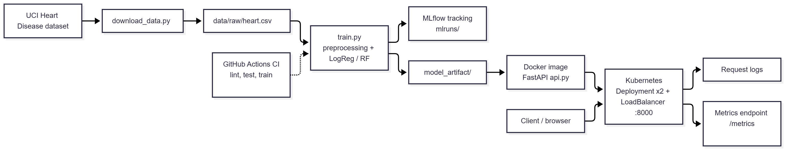

# Heart Disease Risk MLOps

End-to-end MLOps project for predicting heart disease risk from the UCI Heart Disease (Cleveland) dataset. It covers data preparation, model training with experiment tracking, unit tests and CI, containerisation, Kubernetes deployment, and request monitoring.

## Prerequisites

- Python 3.13
- Git
- Docker Desktop, with Kubernetes enabled (Settings > Kubernetes)
- Internet access for the dataset download

## Architecture


## 1. Clone and set up the environment

```powershell
git clone https://github.com/arunank2001-sketch/mlOps_Assignment.git
python -m venv .venv
.venv\Scripts\Activate.ps1          # Windows PowerShell
# source .venv/bin/activate         # macOS / Linux
python -m pip install --upgrade pip
python -m pip install -r requirements.txt
```

## 2. Download the dataset

```powershell
python src/download_data.py
```

This fetches the UCI Heart Disease dataset with `ucimlrepo` and writes `data/raw/heart.csv` (303 rows).

## 3. Train the models

```powershell
python src/train.py
```

This runs cross-validated evaluation for Logistic Regression and a tuned Random Forest, and logs parameters, metrics, and models to MLflow. To view the runs:

```powershell
mlflow ui
```

Then open http://127.0.0.1:5000.

## 4. Run the tests and lint

```powershell
python -m ruff check src tests
python -m pytest tests -v
```

## 5. Run the API locally

The exported model is stored in `model_artifact/`. Start the server:

```powershell
python -m uvicorn api:app --app-dir src --port 8000
```

Open the interactive docs at http://127.0.0.1:8000/docs.

Endpoints:

- `GET /health`: liveness check
- `POST /predict`: returns `prediction` (0 or 1) and `confidence` (probability of disease)
- `GET /metrics`: Prometheus metrics

Request logs are written to `logs/api_requests.log`.

## 6. Build and run the Docker container

```powershell
docker build -t heart-disease-api .
docker run -p 8000:8000 heart-disease-api
```

Then open http://127.0.0.1:8000/docs.

## 7. Deploy to Kubernetes (Docker Desktop)

Kubernetes must be enabled in Docker Desktop. The image is loaded into the cluster node, since the deployment uses `imagePullPolicy: Never`:

```powershell
docker save heart-disease-api:latest -o heart-disease-api.tar
docker cp heart-disease-api.tar desktop-control-plane:/heart-disease-api.tar
docker exec desktop-control-plane ctr -n k8s.io images import /heart-disease-api.tar
del heart-disease-api.tar

kubectl config use-context docker-desktop
kubectl apply -f k8s/deployment.yaml
kubectl get pods
kubectl get svc
```

When both pods show `1/1 Running`, open http://localhost:8000/docs.

## Project structure

```
src/           API, preprocessing, training, data download
tests/         Unit tests
notebooks/     EDA notebook and figures
k8s/           Kubernetes deployment and service manifests
screenshots/   Evidence for the report
model_artifact/ Exported model used by the API
```

## CI/CD

GitHub Actions (`.github/workflows/ci.yml`) runs on every push:

1. Lint with ruff
2. Download the dataset
3. Run the unit tests
4. Train the models
5. Upload the test results and MLflow runs as artifacts

The pipeline fails if any step fails.

## Notes

- Models are saved in cloudpickle format. Only load model files from trusted sources.
- The Kubernetes deployment runs on Docker Desktop, not a cloud cluster, so the API is available on localhost only.